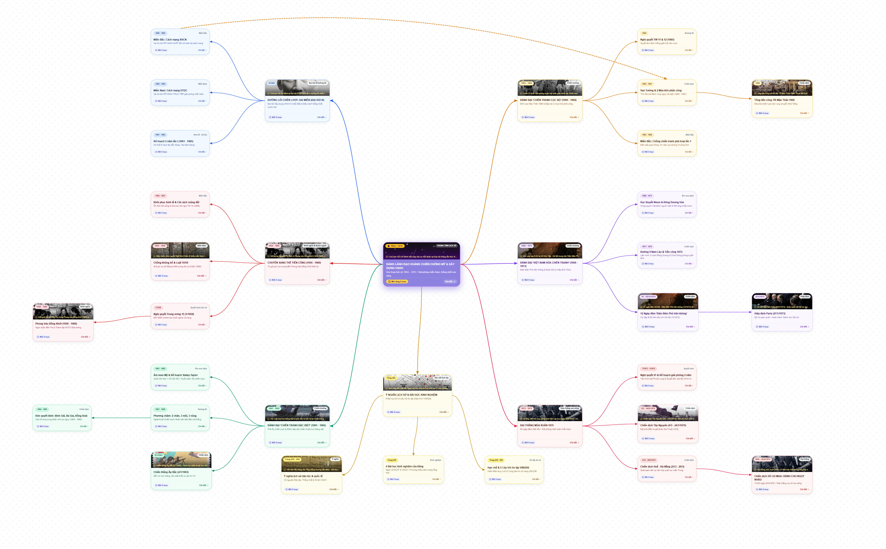

# 🇻🇳 SƠ ĐỒ TƯ DUY TƯƠNG TÁC: LỊCH SỬ ĐẢNG GIAI ĐOẠN 1954 – 1975 (VNR202)

Ứng dụng sơ đồ tư duy (Interactive Mind Map) học tập trực quan môn **Lịch sử Đảng Cộng sản Việt Nam (VNR202) - FPT University**, bám sát 100% nội dung giáo trình chuẩn từ **trang 180 đến trang 236**.

🌐 **Trải nghiệm trực tiếp (Live Demo):**  
👉 **[https://datmnt-dev.github.io/vnr202-mindmap-1954-1975/](https://datmnt-dev.github.io/vnr202-mindmap-1954-1975/)**

---

## 📸 Giới thiệu tổng quan



Dự án được xây dựng với mục tiêu trực quan hóa toàn bộ tiến trình lịch sử kháng chiến chống Mỹ cứu nước và xây dựng CNXH ở miền Bắc (1954 – 1975) qua 34 mốc sự kiện logic, phong cách thiết kế Pastel thanh lịch, dễ tiếp thu và ghi nhớ.

---

## ✨ Điểm nổi bật & Tính năng chính

1. **Chuẩn xác nội dung Giáo trình VNR202 (Trang 180 – 236):**
   - Đầy đủ 7 nhánh chiến lược lớn và các bước đột phá:
     - Khôi phục miền Bắc & Phong trào Đồng Khởi (1954 – 1960).
     - Đường lối Đại hội III (1960) & Kế hoạch 5 năm lần 1.
     - Đánh bại chiến lược "Chiến tranh đặc biệt" (1961 – 1965) - Chiến thắng Ấp Bắc.
     - Đánh bại chiến lược "Chiến tranh cục bộ" (1965 – 1968) - Tổng tiến công Tết Mậu Thân 1968.
     - Đánh bại chiến lược "Việt Nam hóa chiến tranh" (1969 – 1973) - 12 ngày đêm Điện Biên Phủ trên không & Hiệp định Paris 1973.
     - Đại thắng Mùa Xuân 1975 (Tây Nguyên, Huế - Đà Nẵng, Chiến dịch Hồ Chí Minh lịch sử).
     - Ý nghĩa lịch sử, bài học kinh nghiệm và các câu hỏi ôn tập trọng tâm.

2. **14 Hình ảnh tư liệu lịch sử thật:**
   - Sử dụng ảnh tư liệu lịch sử chân thực (Bác Hồ bắt nhịp bài ca Kết đoàn 1960, Nữ tướng Nguyễn Thị Định & Đội quân tóc dài, Xác B-52 hồ Hữu Tiệp, Xe tăng 390 húc tung cổng Dinh Độc Lập, Bản tuyên bố đầu hàng của Dương Văn Minh,...).

3. **Chế độ Mở rộng 5 Mục Chi Tiết Trực Tiếp Trên Thẻ (Expanded 5-Section Mode):**
   - Không cần phải mở ngăn kéo bên cạnh, người học có thể bật chế độ xem nhanh 5 mục cốt lõi của từng sự kiện:
     1. 📌 **Bối cảnh lịch sử**
     2. 🚩 **Quyết sách của Đảng**
     3. ⚔️ **Diễn biến chính & Các mốc quan trọng**
     4. 📊 **Số liệu & Chiến công chiến trường**
     5. 🌟 **Ý nghĩa lịch sử & Bài học kinh nghiệm**
     - Kèm số trang đối chiếu chuẩn trong giáo trình VNR202.

4. **Hệ thống liên kết & Mũi tên động (Live Anchor Docking):**
   - Sử dụng thuật toán tính toán tọa độ biên thực tế (`getAnchors()`) theo kích thước thẻ (dù thu gọn hay mở rộng), đảm bảo mũi tên nối chuẩn xác vào viền mép thẻ, không bị lệch hoặc đứt đoạn.

5. **Xuất & Tải bản PDF / PNG Siêu nét:**
   - Nút **[📥 Tải PDF]** hỗ trợ tải file PDF nguyên khối 1 trang (`mindmap_1954_1975.pdf`) và ảnh chụp toàn cảnh độ phân giải cao (`mindmap_1954_1975.png`) phục vụ in ấn hoặc chèn vào slide thuyết trình.

6. **Tương tác linh hoạt:**
   - Kéo rê (pan), cuộn chuột phóng to / thu nhỏ (zoom) mượt mà với GSAP Draggable.
   - Thanh niên biểu (timeline filter) lọc sự kiện theo từng giai đoạn năm.
   - Tìm kiếm nhanh từ khóa (Ấp Bắc, Mậu Thân, Paris, Nghị quyết 15,...).

---

## 🛠️ Công nghệ sử dụng

- **HTML5 & CSS3** với `@media print` tối ưu in ấn.
- **Tailwind CSS (CDN)** - Phong cách Pastel Palette, tối giản, trang nhã.
- **GSAP 3.12 (GreenSock) & Draggable** - Trải nghiệm điều hướng canvas mượt mà 60 FPS.
- **Lucide Icons** - Bộ icon trực quan, hiện đại.
- **GitHub Actions & GitHub Pages** - Tự động hóa quy trình CI/CD triển khai trang web.

---

## 📁 Cấu trúc thư mục

```text
├── index.html                   # Trang chủ hiển thị sơ đồ tương tác
├── mindmap_1954_1975.html       # Bản sao lưu cấu trúc file gốc
├── mindmap_1954_1975.pdf        # File PDF 1 trang nguyên khối chuẩn in ấn (19.4 MB)
├── mindmap_1954_1975.png        # File ảnh toàn cảnh độ nét cao (4350 x 2700 px)
├── images/                      # Thư mục 14 ảnh tư liệu lịch sử thực tế
├── .github/
│   └── workflows/
│       └── deploy.yml           # Workflow tự động deploy lên GitHub Pages
├── .gitignore                   # Loại trừ các file rác và tài liệu ngoài lề
└── README.md                    # Tài liệu hướng dẫn dự án
```

---

## 🚀 Hướng dẫn chạy trên máy cá nhân (Local)

1. Clone repository về máy:
   ```bash
   git clone https://github.com/datmnt-dev/vnr202-mindmap-1954-1975.git
   cd vnr202-mindmap-1954-1975
   ```

2. Mở file `index.html` bằng trình duyệt bất kỳ (Chrome, Edge, Firefox, Brave) hoặc dùng tiện ích **Live Server** trên VS Code.

---

## 👨‍💻 Tác giả
- Sinh viên FPT University
- Môn học: **VNR202 - Lịch sử Đảng Cộng sản Việt Nam**
- GitHub: [@datmnt-dev](https://github.com/datmnt-dev)
